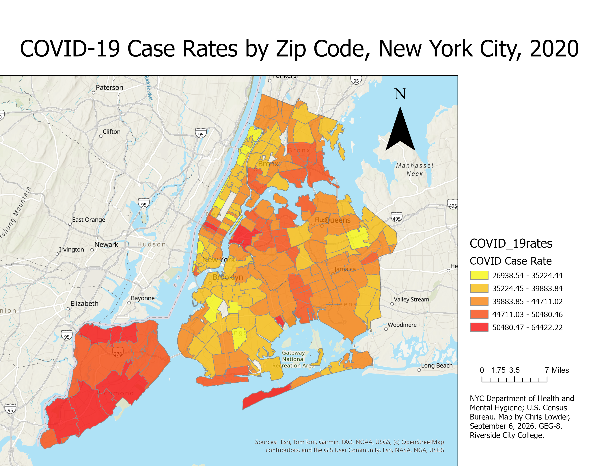
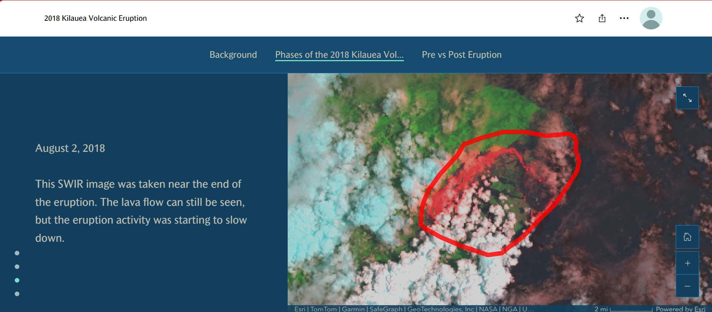

# Chris Lowder

I'm currently studying Geographic Information Systems (GIS) at Riverside City College. I also work in public safety, and I'm interested in how GIS can help us understand geographic patterns, respond to emergencies, and make better decisions about where resources are needed.

## COVID-19 Case Rates by ZIP Code in New York City, 2020

Question: How did reported COVID-19 case rates vary across different ZIP codes in New York City during 2020?

Data: This map uses COVID-19 information from the New York City Department of Health and Mental Hygiene and population information from the U.S. Census Bureau. The map represents COVID-19 conditions during 2020.

Method: I created this map in ArcGIS Pro using COVID-19 case rate data for New York City ZIP codes. I used a choropleth map to display the different rates geographically and organized the values into five color categories. I also created a finished layout with a title, legend, north arrow, scale bar, and data sources.

A design choice I made and why: I used a yellow-to-red color scheme, with yellow representing lower case rates and red representing higher rates. I chose these colors because they make the differences between areas easy to recognize. I also focused on case rates rather than just total case counts, since ZIP codes have different population sizes.

A limitation of this map: The map only represents the available data from 2020 and does not show how conditions changed over time. Differences in testing and reporting could also affect the numbers. It shows where case rates were higher, but it doesn't explain exactly why those differences occurred.

## Tracking the 2018 Kilauea Volcanic Eruption Using Satellite Imagery

*Interactive StoryMap, live as of October 2026: [View the 2018 Kilauea StoryMap](https://storymaps.arcgis.com/stories/154a97f4bcc04a0180dfb31b44f52787)*

Question: How did the landscape around Kilauea change during the 2018 volcanic eruption, and how can satellite imagery help us see those changes?

Data: This project uses Landsat 8 satellite imagery from the U.S. Geological Survey and a 2018 lava-flow extent layer provided through Esri's GIS learning materials. The imagery includes dates before, during, and after the eruption.

Method: I used ArcGIS Online and ArcGIS StoryMaps to organize satellite images from several dates into an interactive presentation. I compared imagery from March 2018, July 2018, August 2018, and February 2019. I also included a swipe comparison to show how the landscape changed from before the eruption to after it ended.

A design choice I made and why: I used shortwave infrared (SWIR) imagery to help make the volcanic activity and changes to the landscape easier to identify. I also displayed the lava-flow boundary in red so viewers could quickly see the area affected by the eruption. Showing several dates helps tell the story better than using a single image.

A limitation of this map: Satellite images only show conditions at the times they were captured, so they cannot show every change that happened during the eruption. Cloud cover can also make some areas difficult to see. The lava-flow boundary provides a general view of the affected area rather than showing every detail on the ground.

## Data Sources

New York City Department of Health and Mental Hygiene. (2020). COVID-19 data. https://github.com/nychealth/coronavirus-data

U.S. Census Bureau. Population and demographic data. https://data.census.gov/

U.S. Geological Survey. Landsat 8 satellite imagery. https://www.usgs.gov/landsat-missions

U.S. Geological Survey. Kilauea volcano information and 2018 eruption. https://www.usgs.gov/volcanoes/kilauea

Esri. Kilauea 2018 Lava Flow Extents, GIS learning materials. https://learn.arcgis.com/en/

## Where This Is Going

As I continue through this GIS course, I plan to add more maps that show how geographic information can be used to understand real-world problems. I'm especially interested in using GIS for public safety, including emergency response, wildfire planning, population changes, and resource allocation. I would like to eventually use some of these skills to help identify areas where additional emergency services or resources may be needed.
